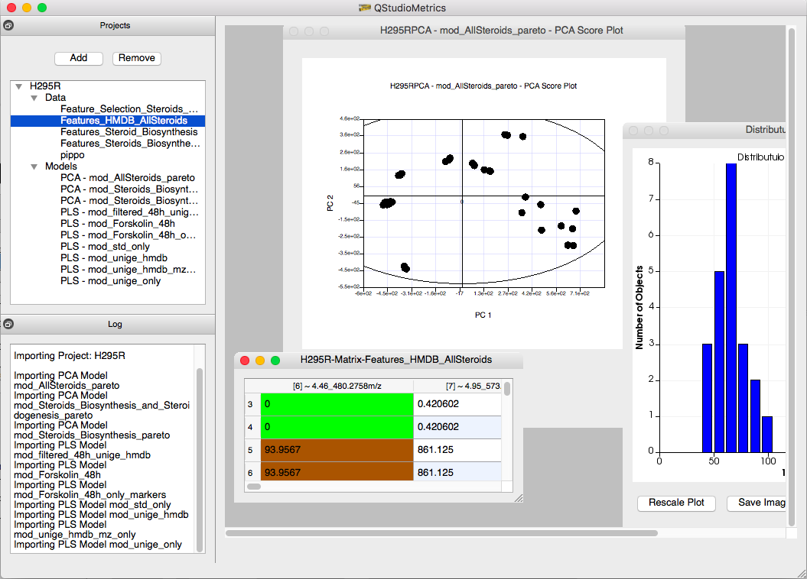
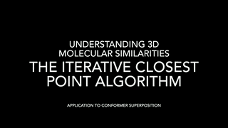
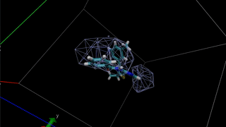
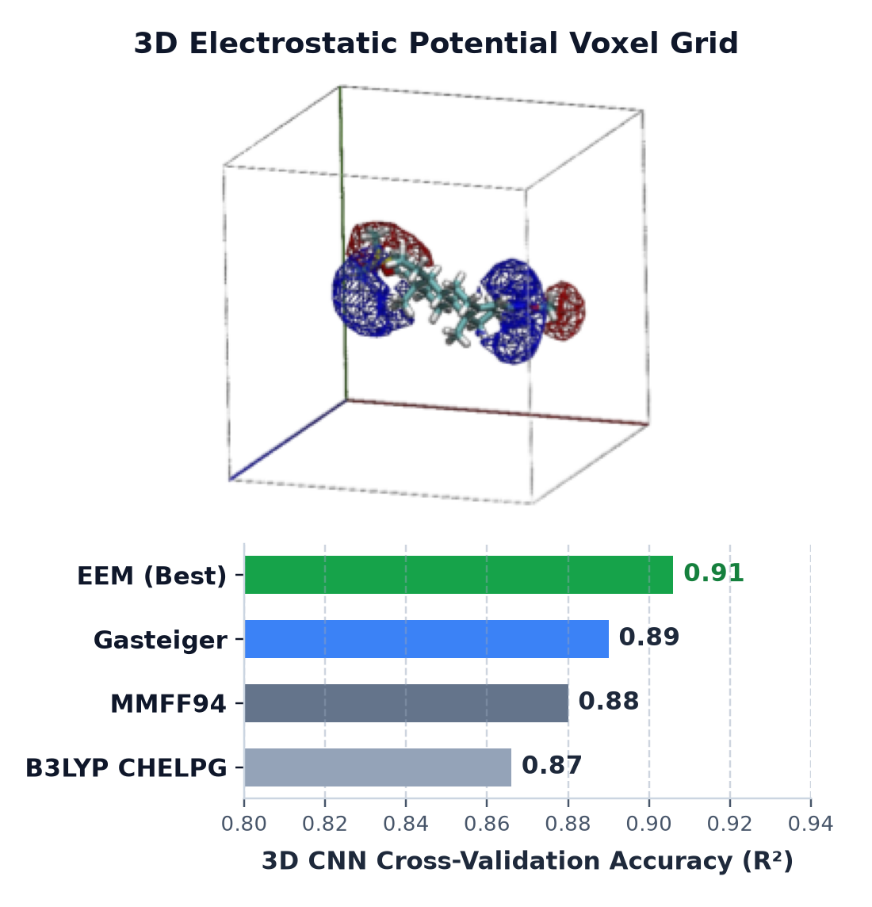
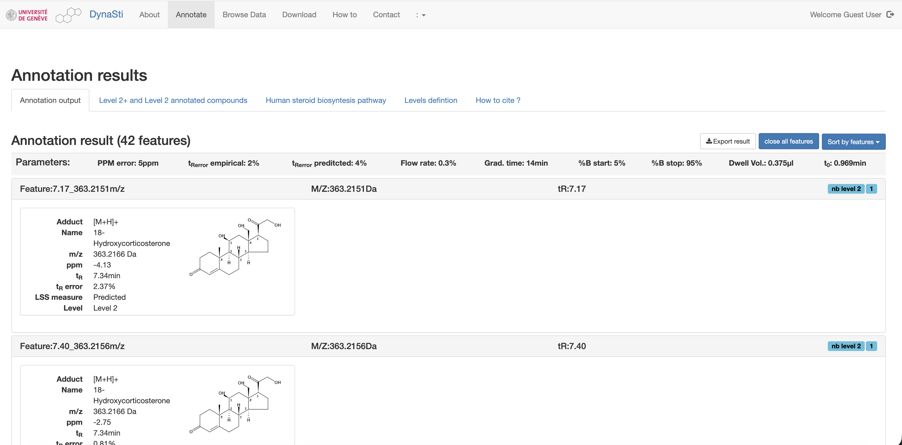

# Giuseppe Marco Randazzo, PhD

### Staff Computational Scientist | Cheminformatics, AI Drug Discovery & High-Performance Computing
**Lugano, Switzerland**

> **Translational Computational Chemist, Cheminformatics & AI Architect** with 15+ years of experience designing and shipping production-grade cheminformatics solutions, bridging molecular biophysics, generative & agentic AI, and high-performance computing (C/C++, CUDA, Python). 
> 
> Proven industry track record discovering and advancing small-molecule therapeutics **from in silico design directly into IND-enabling studies and Phase 1 human clinical trials**.

---

## Key Translational & Industry Milestones

* **From In Silico to Human Clinical Trials (Endogena Therapeutics)**  
  Architected and executed machine learning and structure-based discovery pipelines that directly identified and progressed **1 small-molecule candidate into human clinical trials and a 2nd compound to IND approval**, generating core composition-of-matter patents.

* **Ultra-Large Chemical Space Exploration (Chemify Ltd.)**  
  Engineered de novo molecular generation and synthon-space indexing algorithms capable of querying **multi-trillion virtual compound spaces in under 180 ms** for automated robotic synthesis, accelerating DMTA cycles for global partners including the **Gates Foundation**, **Dewpoint Therapeutics**, and multiple confidential pharmaceutical and biotech clients.

* **Commercial Pipeline Velocity & Series B Technical Foundation (Chemify Ltd.)**  
  Led computational drug design across 6+ commercial target portfolios with a **100% project progression rate** (zero early terminations), delivering potency-enhanced lead series across diverse modalities and building foundational computational capabilities that supported the launch of an automated synthesis facility and a **$50M Series B financing**.

* **Core Open-Source Machine Learning (CatBoost / Hoffmann-La Roche)**  
  Authored native multi-task regression with missing value support in Yandex's **[CatBoost](https://github.com/catboost/catboost/pull/1680)** (PR #1680), solving the sparse experimental bioassay matrix problem for industrial drug discovery.

---

## Industry & Research Experience

* **Staff Scientist** | **Chemify Ltd.** *(Glasgow, UK & Lugano, Switzerland)* | `2023 - Present`  
  Lead computational architect for trillion-scale de novo molecular generation, biomolecular cofolding (Boltz-2 fine-tuning), and multi-parameter lead optimization (potency, metabolic stability, SAScore) across 6+ commercial discovery programs for public and confidential biopharma partners.

* **Head of AI and Cheminformatics** | **Endogena Therapeutics** *(Zurich, Switzerland)* | `2021 - 2023`  
  Directed AI and computational chemistry discovery pipelines for regenerative medicine; advanced 1 candidate into clinical trials and 1 candidate to IND. Architected distributed multi-GPU compute infrastructure and scientific data platforms.

* **Postdoctoral Research Scientist** | **Hoffmann-La Roche** *(Basel, Switzerland)* | `2019 - 2021`  
  Researched multi-task deep learning and gradient boosting architectures for on-target potency and off-target safety profiling across sparse high-throughput screening matrices; contributed core multi-task engine to CatBoost.

* **Research Scientist** | **Dalle Molle Institute for Artificial Intelligence (IDSIA)** *(Lugano, Switzerland)* | `2017 - 2019`  
  Pioneered 3D geometric deep learning and voxelized quantum/electrostatic molecular representations for early-stage drug discovery and biomarker identification (Innosuisse ARCADIA project).

* **Postdoctoral Researcher & External CADD Consultant** | **University of Geneva & Firmenich** *(Geneva, Switzerland)* | `2014 - 2017`  
  Discovered novel LIM Kinase inhibitors via structure-based modeling as an independent CADD consultant; engineered machine learning platforms for physicochemical property prediction in collaboration with the Swiss Institute of Bioinformatics (Vital-IT).

---

## Core Scientific & Technical Pillars

### 1. Biomolecular Cofolding & Structure-Based Drug Design
* **All-Atom Cofolding & Affinity Ranking**: Fine-tuning and deploying cofolding architectures (Boltz-2, AlphaFold) for simultaneous protein-ligand complex prediction, pocket conditioning, and binding affinity estimation.
* **Physics-Based Free Energy Simulations**: Relative Binding Free Energy (RBFE via OpenFE and AMBER-TI), Molecular Dynamics (MD), and QM/MM calculations to guide medicinal chemistry synthesis.
* **Challenging Target Classes, Modalities & Therapeutic Areas**: Proven track record across **Ion Channels, Protein-Protein Interactions (PPIs), Peptidomimetics, Small Molecules, Kinases, Sirtuins, HDACs, and Epigenetic targets**, spanning Oncology, Regenerative Medicine, Fibrosis (IPF), CNS/Neurobiology, and Infectious Diseases.

### 2. Production Cheminformatics & High-Performance Scientific Computing
* **End-to-End Cheminformatics Solutions**: Designing and shipping production-grade toolchains for ultra-large chemical library enumeration, molecular descriptor/fingerprint generation, chemical space mapping, and QSAR/QSPR modeling.
* **Zero-Dependency Numerical Engines**: Author of **[libscientific](https://github.com/gmrandazzo/libscientific)** (published in *JOSS*), an ANSI C99 library implementing NIPALS PCA, PLS, Consensus PCA, Nelder-Mead optimization, and SVD with Python FFI bindings.
* **Cross-Platform Analytical Suites & GPU Acceleration**: Creator of **[QStudioMetrics](https://github.com/gmrandazzo/QStudioMetrics)** (C++20 desktop suite) and high-throughput C/C++ and CUDA algorithms designed for distributed multi-GPU HPC environments.

### 3. Agentic AI Workflows, Multi-Parameter Optimization (MPO) & Autonomous DMTA
* **Agentic Discovery & Tool-Use Systems**: Designing autonomous LLM- and agent-driven workflows (RAG, scientific reasoning, and multi-agent tool orchestration) that connect unstructured literature/patent intelligence directly to executable cheminformatics, cofolding, and simulation pipelines.
* **Multi-Parameter Lead Optimization (MPO)**: Simultaneous optimization of potency, target selectivity, ADMET properties, physicochemical profiles (logD, solubility, permeability), and synthetic accessibility (SAScore / retrosynthesis).
* **Closed-Loop DMTA Integration**: Active learning, Bayesian optimization, and uncertainty quantification integrated into automated Design-Make-Test-Analyze (DMTA) cycles.

---

## Selected Open-Source Systems & Scientific Platforms

<table width="100%">
  <tr>
    <td width="260" align="center">
      
    </td>
    <td align="left">
      <a href="https://github.com/gmrandazzo/libscientific"><b>libscientific: Zero-Dependency C Numerical Engine</b></a> 
      High-performance C99 library for multivariate statistical analysis, numerical optimization, and chemometrics with full Python FFI bindings. Designed for speed, reproducibility, and zero external dependencies.  
      
      
      
      
    </td>
  </tr>

  <tr>
    <td width="260" align="center">
      
    </td>
    <td align="left">
      <a href="https://github.com/catboost/catboost/pull/1680"><b>CatBoost: Multi-Task Learning on Sparse Bioassay Matrices</b></a> 
      Engineered core C++/Python support in Yandex's CatBoost for multi-task regression with missing target labels, enabling simultaneous modeling of correlated biological endpoints across incomplete screening matrices.  
      
      
      
      
    </td>
  </tr>

  <tr>
    <td width="260" align="center">
      
    </td>
    <td align="left">
      <a href="https://github.com/gmrandazzo/QStudioMetrics"><b>QStudioMetrics: C++20 Multivariate & QSAR Suite</b></a> 
      Cross-platform C++20 desktop application for exploratory data analysis, PCA/PLS, MLR, and rigorous QSAR model validation (K-Fold cross-validation, Leave-One-Out, and Y-Scrambling).  
      
      
      
    </td>
  </tr>

  <tr>
    <td width="260" align="center">
       
      
      
    </td>
    <td align="left">
      <a href="https://github.com/gmrandazzo/MolecularFramework"><b>MolecularFramework: 3D Conformer & Electrostatic Field Engine</b></a> 
      C/C++ molecular modeling library implementing Iterative Closest Point (ICP) 3D conformer alignment, van der Waals surface shape similarity, and 3D molecular electrostatic potential field calculation.  
      
      
      
      
    </td>
  </tr>

  <tr>
    <td width="260" align="center">
      
    </td>
    <td align="left">
      <a href="https://github.com/gmrandazzo/DeepMolecularNetwork"><b>DeepMolecularNetwork: 3D Quantum & Electrostatic Voxel CNNs</b></a> 
      Multi-modal deep learning framework utilizing 3D voxelized grids of quantum/force-field electrostatic potentials (B3LYP CHELPG, MMFF94, EEM) and electron density for physicochemical property prediction.  
      
      
      
      
    </td>
  </tr>

  <tr>
    <td width="260" align="center">
      
    </td>
    <td align="left">
      <a href="https://dynasti.vital-it.ch/"><b>DynaStI & PyLSS: Physicochemical Property & Retention Modeling</b></a> 
      Predictive physicochemical modeling platform deployed at the Swiss Institute of Bioinformatics (Vital-IT) alongside <a href="https://github.com/gmrandazzo/PyLSS"><b>PyLSS</b></a> (Linear Solvent Strength simulation) for automated structure annotation and biomarker discovery.  
      
      
      
      
    </td>
  </tr>
</table>

---

## Technical Competencies

| Domain | Methods & Technologies |
| :--- | :--- |
| **Targets, Modalities & Disease Areas** | Ion Channels, Protein-Protein Interactions (PPIs), Peptidomimetics, Small Molecules, Kinases, HDACs/Sirtuins, Epigenetics *(Oncology, Regenerative Medicine, Fibrosis, Infectious Disease)* |
| **Biomolecular Modeling & CADD** | Boltz-2, AlphaFold, OpenFE (RBFE), AMBER-TI, Molecular Dynamics, GOLD, AutoDock, DiffDock, QM/MM |
| **Generative AI, Agents & Machine Learning** | Agentic AI Workflows, LLMs, RAG, Tool-Use Orchestration, PyTorch, CatBoost, Scikit-Learn, Multi-Task Learning, Geometric Deep Learning, 3D Voxel CNNs, GNNs |
| **High-Performance Languages** | Modern C++ (C++20), ANSI C (C99), Python (ctypes/C-API/FFI), CUDA, Go, Rust, Bash, SQL |
| **Cheminformatics & Analytics** | RDKit, Multi-Parameter Optimization (MPO), QSAR/QSPR, NIPALS PCA, PLS, Consensus PCA, LC-MS/MS, GCxGC |
| **MLOps, Compute & Infrastructure** | Apache Airflow, Dagster, MLflow, Multi-GPU HPC Clusters, Kubernetes, Docker, Linux/GNU Toolchain, AWS (EC2, S3), Git, CI/CD |

---

## Selected Publications

- **libscientific: A Powerful C Library for Multivariate Analysis**  
  *G. M. Randazzo* - *The Journal of Open Source Software (JOSS)*, 8(87), 5420 (2023). [DOI: 10.21105/joss.05420](https://doi.org/10.21105/joss.05420)
- **Steroid identification via deep learning retention time predictions and two-dimensional gas chromatography-high resolution mass spectrometry**  
  *G. M. Randazzo, A. Bileck, A. Danani, B. Vogt, M. Groessl* - *Journal of Chromatography A*, 1640, 461965 (2021). [ScienceDirect](https://www.sciencedirect.com/science/article/abs/pii/S0021967319310830) / [DOI: 10.1016/j.chroma.2019.460661](https://doi.org/10.1016/j.chroma.2019.460661)
- **DynaStI: A Dynamic Retention Time Database for Steroidomics**  
  *S. Codesido, G. M. Randazzo, F. Lehmann, et al.* - *Metabolites*, 9(12), 291 (2019). [DOI: 10.3390/metabo9120291](https://doi.org/10.3390/metabo9120291)
- **A Rational Approach for the Identification of Non-Hydroxamate HDAC6-Selective Inhibitors**  
  *L. Goracci, N. Deschamps, G. M. Randazzo, et al.* - *Scientific Reports*, 6, 29086 (2016). [DOI: 10.1038/srep29086](https://doi.org/10.1038/srep29086)
- **Discovery of Novel, Potent, and Specific Cell-Death Inducers in the Jurkat Acute Lymphoblastic Leukemia Cell Line**  
  *E. Carosati, N. van den Hofel, M. Reif, G. M. Randazzo, et al.* - *ChemMedChem*, 10(9), 1541-1554 (2015). [DOI: 10.1002/cmdc.201500222](https://doi.org/10.1002/cmdc.201500222)

*Complete list of 20+ peer-reviewed articles available on [Google Scholar](https://scholar.google.com/citations?user=wVq-c3IAAAAJ&hl=en).*

---

## Education

* **PhD in Chemical Science** | *University of Perugia, Italy* (2010 - 2013)  
  *Quantitative Structure-Property/Retention Relationships, physicochemical modeling, and metabolomics.*
* **Master of Science in Organic Chemistry** | *University of Perugia, Italy* (2008 - 2010)  
  *Computational selection and organic synthesis of biologically active compounds.*
* **Bachelor of Science in Chemistry** | *University of Catania, Italy* (2004 - 2008)  
  *Microwave-assisted organic synthesis of therapeutic candidates.*

---

## Open-Source Philosophy & Beyond the Lab

I have been crafting cheminformatics and scientific software since 2008, writing C, C++, and Python (and more recently **Go** and **Rust**) to analyze, visualize, and predict molecular properties, turning complex chemical data into real-world discoveries.

At heart, I am a lifelong **Linux/Unix enthusiast** (Gentoo, Debian, and Fedora with KDE Plasma) and a committed supporter of the open-source ecosystem, including upstream contributions to the **[Linux Kernel](https://lore.kernel.org/linux-wireless/20200405220659.45621-1-chunkeey@gmail.com/#r)** and community tools like **[Mindguard](https://github.com/asbestomolesto/mindguard)**.

Outside of computational science, I am an avid **distance runner**, holding a **[1h 14m Half Marathon (21.1 km) personal best](https://apiah.endu.net/events/99979/result/259/diploma)** *(finishing 70th out of 10,806 overall participants and 9th out of 640 in the SM40 category)*, and enjoy spending time with my family, playing the **French horn**, **inline skating**, and restoring vintage computing hardware.

---

## Contact

Always happy to connect with fellow scientists, founders, and R&D leaders on AI-driven drug discovery, biomolecular simulation, and high-performance cheminformatics.

- **Email**: [gmrandazzo@gmail.com](mailto:gmrandazzo@gmail.com)
- **LinkedIn**: [linkedin.com/in/gmrandazzo](https://www.linkedin.com/in/gmrandazzo/)
- **GitHub**: [github.com/gmrandazzo](https://github.com/gmrandazzo)
- **Google Scholar**: [Giuseppe Marco Randazzo](https://scholar.google.com/citations?user=wVq-c3IAAAAJ&hl=en)
- **Location**: Lugano, Switzerland
